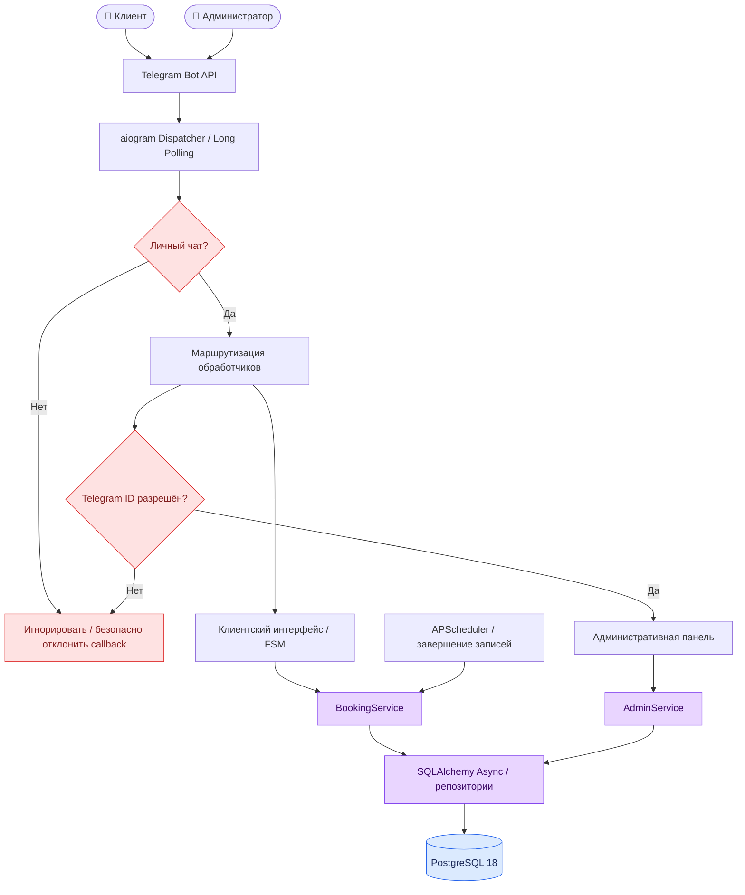
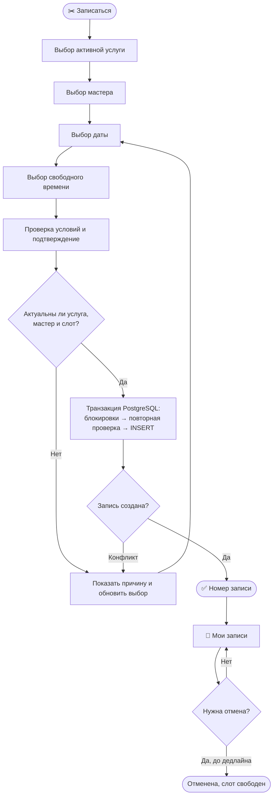
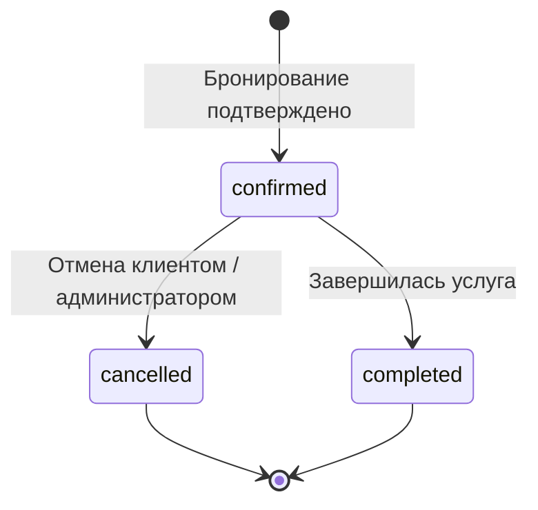

<div align="center">
  <h1>💈 BarberBot</h1>
  <h3>Telegram-бот для онлайн-записи в барбершоп</h3>
  <p><strong>Завершённый рабочий прототип · Python 3.14 · aiogram 3 · PostgreSQL 18</strong></p>
  <p>
    <a href="https://github.com/Addqd/barberbot"></a>
    <a href="https://core.telegram.org/bots/api"></a>
    <a href="#авторство-и-права"></a>
  </p>
  <p><strong>Автор и правообладатель: <a href="https://github.com/Addqd">@Addqd</a></strong></p>
  <p>
    <a href="https://github.com/Addqd/barberbot">Репозиторий</a> ·
    <a href="#возможности">Возможности</a> ·
    <a href="#архитектура">Архитектура</a> ·
    <a href="#быстрый-запуск">Запуск</a> ·
    <a href="#проверка-качества">Проверки</a>
  </p>
</div>

---

## О проекте

**BarberBot** — законченный портфолио-проект: Telegram-бот для записи клиентов **одного барбершопа** и управления его ежедневной работой. Клиент выбирает услугу, мастера и свободное время, а администратор управляет каталогом, расписанием и бронированиями непосредственно в Telegram.

> **Статус: завершённый, проверенный и протестированный рабочий прототип.** Разработка заявленной функциональности завершена; реализованы автоматизированные проверки пользовательских, административных, конкурентных и защитных сценариев, выполнено ревью исходного кода. Проект готов к запуску и эксплуатации **в рамках рабочего прототипа** при наличии настроенного окружения и PostgreSQL. Это не дорожная карта и не проект «в активной разработке».

Бот использует **Telegram Long Polling**, асинхронный доступ к PostgreSQL и транзакционную бизнес-логику. Отдельный веб-сайт, API-сервер и публичный HTTPS-адрес для локального запуска не требуются.

## Возможности

<table>
  <tr>
    <td width="50%" valign="top">
      <h3>✂️ Для клиента</h3>
      <ul>
        <li>Каталог актуальных услуг и цен.</li>
        <li>Выбор услуги → мастера → даты → свободного времени.</li>
        <li>Подтверждение записи с итоговой стоимостью и длительностью.</li>
        <li>Раздел <strong>«Мои записи»</strong>: список, детали, история.</li>
        <li>Отмена своей записи не позднее чем за <strong>2 часа</strong> до начала.</li>
        <li>Навигация и обработка устаревших кнопок.</li>
      </ul>
    </td>
    <td width="50%" valign="top">
      <h3>⚙️ Для администратора</h3>
      <ul>
        <li>Доступ только по разрешённому <strong>Telegram ID</strong>.</li>
        <li>Создание, изменение и отключение услуг.</li>
        <li>Добавление и отключение мастеров.</li>
        <li>Управление рабочими часами и отсутствиями.</li>
        <li>Записи с фильтрами по дате и мастеру.</li>
        <li>Отмена клиентской записи с подтверждением.</li>
        <li>Защита записей при изменении графика.</li>
      </ul>
    </td>
  </tr>
</table>

**Автоматизация:** по окончании услуги запись переводится из `confirmed` в `completed`. Проверка выполняется при запуске бота и далее раз в минуту; после перезапуска пропущенные завершения обрабатываются автоматически.

### Основные правила бронирования

| Правило | Реализация |
|---|---|
| Часовой пояс | `Europe/Moscow` |
| Шаг начала записи | 30 минут |
| Доступность | Рабочие часы, длительность услуги, отсутствие мастера, занятые интервалы |
| Пересечение записей | Запрещено на уровне PostgreSQL |
| Отмена клиентом | Только собственная запись, не позднее чем за 2 часа |
| Отмена администратором | Разрешена после отдельного подтверждения; завершённые записи не отменяются |
| Изменение цен и длительности | Не меняет сохранённые условия существующих записей |
| График и отсутствия | Конфликтующие изменения отклоняются, действующие записи сохраняются |

## Архитектура

Проект разделяет Telegram-интерфейс, бизнес-логику и слой хранения данных. Правила записи и полномочия не определяются содержимым кнопок или клиентским состоянием FSM.



### Путь клиента: от выбора услуги до записи



### Защита от конкурентных изменений

Даже если администратор меняет расписание одновременно с клиентским бронированием, итоговые данные согласуются **внутри транзакций**. Первичная проверка слота предназначена для интерфейса; окончательное решение принимает сервер после блокировок.

```mermaid
sequenceDiagram
    autonumber
    participant C as Клиент
    participant B as BookingService
    participant DB as PostgreSQL
    participant A as AdminService

    C->>B: Запросить запись
    B->>DB: Предварительная проверка доступности
    DB-->>B: Доступно на момент проверки
    B->>DB: BEGIN; блокировка мастера FOR UPDATE
    B->>DB: Блокировка услуги FOR UPDATE
    B->>DB: Повторная проверка графика и занятости
    A->>DB: Попытка изменить график мастера
    Note over A,DB: Ожидание блокировки той же строки мастера
    B->>DB: INSERT записи + COMMIT
    DB-->>B: Запись подтверждена
    DB-->>A: Блокировка доступна
    A->>DB: Проверка конфликтующих записей
    DB-->>A: Новая запись уже видна
    A-->>A: Отклонить конфликтующее изменение
    B-->>C: ✅ Подтверждение
```

Дополнительный уровень защиты — PostgreSQL `EXCLUDE`-ограничение `ex_bookings_barber_no_overlap`, исключающее пересекающиеся активные бронирования одного мастера. Конфликт `SQLSTATE 23P01` обрабатывается как доменная ошибка, без раскрытия внутренних подробностей БД.

### Жизненный цикл записи



## Технологии

| Компонент | Технология |
|---|---|
| Язык | Python `3.14.10` |
| Telegram | aiogram 3.x, Long Polling, FSM, inline-клавиатуры |
| Данные | PostgreSQL 18, SQLAlchemy 2.x Async, Psycopg 3 |
| Миграции | Alembic |
| Конфигурация | Pydantic Settings |
| Фоновые задачи | APScheduler 3.x — только автоматическое завершение записей |
| Управление окружением | uv, Poe the Poet |
| Качество | pytest, pytest-asyncio, pytest-cov, Ruff, mypy |
| База в локальном окружении | Docker Compose |

## Быстрый запуск

**Поддерживаемый сценарий разработки и демонстрации:** Windows 10, PowerShell, установленный Python 3.14 (управляется через `uv`), `uv`, Docker с Compose и доступ к Telegram Bot API.

### 1. Подготовка окружения

Перейдите в корень проекта и установите зависимости по `uv.lock`:

```powershell
uv sync
Copy-Item .env.example .env
```

Заполните `.env` своими значениями:

```dotenv
BOT_TOKEN=YOUR_TELEGRAM_BOT_TOKEN
ADMIN_TELEGRAM_IDS=123456789

POSTGRES_HOST=127.0.0.1
POSTGRES_PORT=5433
POSTGRES_DB=barberbot
POSTGRES_USER=barberbot
POSTGRES_PASSWORD=YOUR_STRONG_PASSWORD
```

`ADMIN_TELEGRAM_IDS` — ваш числовой Telegram ID; для нескольких администраторов укажите ID через запятую. Пустой или отсутствующий список **не даёт никому административных прав**. ID можно узнать через Telegram-ботов, отображающих ID аккаунта, или из журналов `/start` BarberBot. Не публикуйте реальный токен бота и пароль БД.

### 2. Запуск PostgreSQL и бота

Все операции приложения и БД выполняются **через существующие Poe-команды**:

```powershell
uv run poe db-up
uv run poe db-upgrade
uv run poe db-seed
uv run poe dev
```

После запуска откройте чат с ботом и отправьте `/start`. Остановка — `Ctrl+C`.

Демо-наполнение добавляется идемпотентным seed-скриптом без перезаписи уже существующих записей:

| Услуга | Цена | Длительность |
|---|---:|---:|
| Обычная стрижка | 500 ₽ | 60 мин |
| Стрижка с укладкой | 650 ₽ | 60 мин |
| Стрижка с мытьём волос | 800 ₽ | 60 мин |

Демо-мастера: **Елена**, **Максим**, **Милана**. Начальный график: **пн–пт, 09:00–17:00**, московское время. Данные можно изменять через админ-панель.

> **Сеть:** aiogram обращается к Telegram Bot API напрямую. Системный прокси Windows (WinINET) автоматически не используется; при блокировке прямого доступа нужен рабочий сетевой маршрут к `api.telegram.org`.
>
> **Windows 10:** для асинхронного Psycopg используется `SelectorEventLoop`, уже предусмотренный в точке входа приложения и тестовых фикстурах.

## Проверка качества

Проект содержит модульные, интеграционные и регрессионные тесты. Они проверяют клиентские и административные операции, ограничения прав, конфликтующие слоты, параллельное бронирование и изменения расписаний. Код прошёл ревью, включая повторную проверку исправлений конкурентности и пагинации.

Для воспроизводимой проверки на своей машине:

```powershell
uv run poe db-test-create
uv run poe db-test-upgrade
uv run poe db-test-smoke
uv run poe check
uv run poe test-cov
```

| Команда | Назначение |
|---|---|
| `uv run poe check` | Ruff lint → форматирование → mypy → pytest |
| `uv run poe test` | Unit- и интеграционные тесты |
| `uv run poe test-cov` | Тесты и процент покрытия исходного кода |
| `uv run poe db-test-smoke` | Проверка тестовой БД и защитных ограничений PostgreSQL |

**Изоляция тестов:** интеграционные тесты используют отдельную базу `<POSTGRES_DB>_test` и проверяют её фактическое имя перед выполнением операций. Основная база и существующие демонстрационные данные не должны изменяться тестами.

Наличие тестов и код-ревью не означает абсолютного отсутствия ошибок: фактический результат запуска команд зависит от окружения. Для работы с реальными клиентами необходимо корректно настроить доступ к Telegram, защиту учётных данных, резервное копирование БД и обработку персональных данных.

## Структура репозитория

```text
barberbot/
├── __main__.py          # запуск бота
├── app.py               # Dispatcher, DI, жизненный цикл
├── config.py            # BOT_TOKEN и ADMIN_TELEGRAM_IDS
├── db_settings.py       # настройки PostgreSQL
├── middleware.py        # ограничение личными чатами
├── booking/             # правила слотов, бронирование, завершение
│   ├── service.py
│   ├── slots.py
│   └── completion.py
├── admin/               # административная логика и UI-компоненты
│   ├── service.py
│   ├── callbacks.py
│   ├── keyboards.py
│   └── texts.py
├── db/                  # ORM, репозитории, AsyncEngine
│   ├── models.py
│   ├── repositories.py
│   └── engine.py
└── handlers/            # клиентские и административные роутеры
    ├── booking.py
    ├── my_bookings.py
    ├── admin.py
    └── fallback.py

alembic/                 # миграции PostgreSQL
scripts/                 # seed и диагностика тестовой БД
tests/                   # unit, integration, security, concurrency
compose.yaml             # PostgreSQL в Docker
pyproject.toml           # зависимости и Poe tasks
uv.lock                  # фиксированные зависимости
```

## Границы прототипа

BarberBot рассчитан на **один барбершоп**. Онлайн-оплата, программа лояльности, полноценная CRM, отдельная веб-панель и автоматические сообщения-напоминания клиентам не входят в реализованную функциональность. Существующая таблица `reminders` — часть схемы данных, **но отправка напоминаний не реализована**. APScheduler используется для обновления статусов уже завершившихся записей.

Проект **не находится в стадии активной разработки**: описанная выше функциональность составляет завершённый объём рабочего прототипа.

## Авторство и права

**Автор, владелец проекта и правообладатель: [Addqd](https://github.com/Addqd).**  
**Copyright © 2026 Addqd. All rights reserved. / Все права защищены.**

Исходный код размещён на GitHub **для демонстрации портфолио и ознакомления**, а не для свободного повторного использования. **Открытая лицензия на проект не предоставляется.** Все исключительные права на исходный код, архитектурные решения, документацию и другие охраняемые результаты, созданные правообладателем, сохраняются за **Addqd**.

**Без предварительного письменного разрешения правообладателя запрещаются копирование, воспроизведение, изменение, распространение, перепубликация и использование материалов проекта в собственных продуктах**, за исключением действий, прямо разрешённых применимым законодательством или обязательными условиями платформы GitHub.

Публичная доступность репозитория сама по себе **не означает передачу авторских прав, отказ от них или предоставление свободной лицензии**. Для получения разрешения на использование свяжитесь с владельцем через [GitHub-профиль Addqd](https://github.com/Addqd).

---

<div align="center">
  <strong>BarberBot · Working Prototype · © 2026 <a href="https://github.com/Addqd">Addqd</a></strong>
</div>
